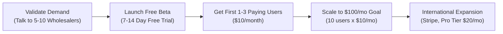

# 📒 StockLedger — Product, Launch & Internationalization Plan

> **Tagline:** Invoices. Payments. Stronger Business.  
> **Mission:** A simple, friendly web app that helps wholesalers and growing businesses worldwide create invoices, track payments, and manage customer balances — so they get paid on time.

---

## 1. Executive Summary & Status Check

### Is it done?
**Core functionality is now complete, internationalized, and verified with zero build errors.**
- **Authentication**: Email/Password Sign Up & Sign In with Supabase.
- **Invoices**: Create invoices with auto-generated IDs (`INV-XXXXX`), due dates, status tracking (`paid`, `pending`, `overdue`), search, and filters.
- **Customers**: Customer directory with phone, email, contact management, and 1-click invoice creation.
- **Payments**: Payment recording against open invoices, auto-updating invoice status to `paid`, and multi-method logging.
- **Reports**: Real-time business analytics, collection rate, 6-month revenue chart, and status distribution pie chart.
- **Settings**: Business name customization, account profile, currency selector, and sign-out.
- **Internationalization**: No longer locked to Myanmar. Multi-currency support (USD, EUR, GBP, SGD, AUD, CAD, JPY, MMK, THB, INR), global payment options (Wire, Cards, Wallets, Cash), and dynamic merchant greetings.

---

## 2. Alignment with Design Concepts (From Image)

The design document outlines 3 visual design concepts:

| Feature / Aspect | Concept 1 (Minimal & Clean) | Concept 2 (LedgerPro Detailed) | Concept 3 (Friendly & Visual) | Current Implementation |
| :--- | :--- | :--- | :--- | :--- |
| **Theme / Aesthetic** | Light, airy, high clarity & speed | Dark sidebar, corporate feel | Dark sidebar, card badges, colorful | **Concept 1 + Concept 3 Hybrid** (Clean, high-contrast, fast, with colorful badges & due alerts) |
| **Greeting** | "Good morning, Ko Myo!" | Search bar header | "Welcome back, Ko Myo!" + avatar | **Dynamic Greeting** ("Good morning/afternoon, {Your Business}!") |
| **Stat Cards** | 3 key cards (Outstanding, Paid, Total) | 3 cards with percentage trends | 3 colorful rounded cards | **3 Dynamic Stat Cards** with live calculations |
| **Reminders / Alerts** | Bell icon | Bell icon + profile | "Due Soon" alert box with warning dots | **Bell notification counter + Due Soon banner** |
| **Sales Overview** | Quick overview | Bar chart (Paid vs Pending) | Payment status donut + transaction list | **Recharts Bar Chart (Paid vs Pending) + Status list + Transactions feed** |
| **Quick Actions** | "+ Create Invoice", "+ Add Customer", "+ Record Payment" | Header action buttons | Link cards | **3 Quick Action Buttons** on dashboard |

---

## 3. Business Plan & Monetization Roadmap



### Goal: $100 / Month
- **Option A**: 10 wholesalers $\times$ $10/month
- **Option B**: 5 wholesalers $\times$ $20/month

### Free Trial Strategy:
- Offer a **7 to 14-day free trial** without requiring a credit card.
- Provide personal onboarding to ensure they create their first 3 invoices and see immediate value.

---

## 4. How to Publish with a Free Domain (Step-by-Step)

You can launch StockLedger to the public with **$0 hosting cost** and a **free domain/subdomain** using Vercel.

### Step 1: Push Code to GitHub
1. Open your terminal in this directory:
   ```bash
   cd "Downloads/Project 1"
   git init
   git add .
   git commit -m "Initial StockLedger release"
   ```
2. Create a repository on [GitHub](https://github.com/new) named `stockledger`.
3. Push your code:
   ```bash
   git remote add origin https://github.com/YOUR_GITHUB_USERNAME/stockledger.git
   git branch -M main
   git push -u origin main
   ```

### Step 2: Deploy on Vercel
1. Go to [vercel.com](https://vercel.com) and sign up with GitHub (free).
2. Click **"Add New..."** → **"Project"**.
3. Select your `stockledger` repository.
4. Under **Environment Variables**, add the 4 keys from your `.env.local` file:
   - `NEXT_PUBLIC_SUPABASE_URL`
   - `NEXT_PUBLIC_SUPABASE_PUBLISHABLE_KEY`
   - `NEXT_PUBLIC_SUPABASE_ANON_KEY`
   - `SUPABASE_SERVICE_ROLE_KEY`
5. Click **"Deploy"**.

### Step 3: Your Free Domain
- Vercel automatically gives you a free HTTPS subdomain:
  `https://stockledger-YOUR_NAME.vercel.app`
- Anyone in the world can access it immediately!
- *(Optional)* If you buy a custom domain later (e.g. `stockledger.com`), you can attach it in Vercel settings for free with automatic SSL.

---

## 5. Pre-Launch Checklist

- [x] Dependencies installed (`@supabase/supabase-js`, `@supabase/ssr`, Next.js 14).
- [x] Environment configured with Supabase credentials (`.env.local`).
- [x] Client, server, and middleware sessions configured.
- [x] Next.js build tested and passing (`13/13 routes static & dynamic`).
- [x] International currency switcher added.
- [x] Global payment methods added.
- [x] Missing Settings page (`/settings`) created with sign-out.
- [ ] **Run SQL schema in Supabase SQL editor** (`supabase/schema.sql`).
- [ ] Test live sign-up and create first test customer + invoice.
- [ ] Push to GitHub and deploy to Vercel.
